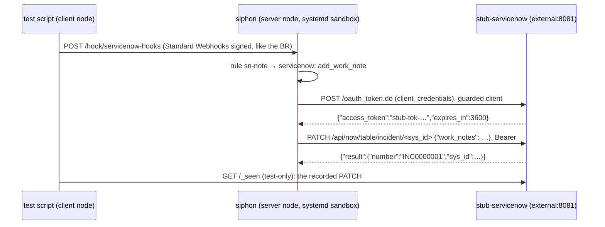

# Spec: ServiceNow end to end in CI, and the official ServiceNow MCP server

## Design

### A. The VM test: the whole chain in CI (`nix/vm-test.nix`, `nix/stub-servicenow.py`)

- **`nix/stub-servicenow.py`:** stdlib `http.server` on `external:8081`.
  - `POST /oauth_token.do` checks the form `grant_type=client_credentials`
    and the configured client ID and secret, and returns a token.
  - `PATCH /api/now/table/incident/<32 hex>` requires that token as a
    Bearer, records the method, path, body and whether the Authorization
    header carried the expected token (never the token itself), and
    returns a `result` with `number` and `sys_id`.
  - `GET /_seen` returns the records.
  - Anything else gets 404.
- **The server node's config** (merged with `lib.recursiveUpdate`, as the
  existing VM config is):
  - add `"external:8081"` to `server.services.private_endpoints`;
  - a `servicenow` mcp source (`package: servicenow`) whose env refs point
    to files under `/etc/siphon/` (the instance URL `http://external:8081`,
    the client ID and the client secret);
  - a `servicenow-hooks` webhook source (`signature: standard-webhooks`,
    with a `whsec_` key from a file);
  - a rule `sn-note`: `when: 'event.table == "incident"'`, `on: each`,
    `id: event.sys_id + ":" + event.sys_mod_count`, `cooldown: 1m`, and
    action `servicenow: {connection: servicenow, op: add_work_note,
    sys_id: "{{.event.sys_id}}", fields: {text: "seen {{.event.number}}"}}`.
- **The test script:**
  - sign a delivery exactly as the #73 Business Rule does (Python
    `hmac`/`base64` over `id.ts.body` with the base64-decoded key), and
    POST it from the client node;
  - wait for the job to be `done`;
  - assert:
    1. the stub saw one PATCH with body `{"work_notes":"seen INC0000001"}`
       and the expected Bearer;
    2. the job output has `servicenow add_work_note incident INC0000001`;
    3. neither the job output nor `journalctl -u siphon` contains the
       client secret or the stub token;
    4. a re-sent identical delivery is a duplicate, with no second PATCH.
- **Not involved:** the bridge. The native action runs in the daemon,
  through the guarded client, which is the path the VM test hasn't covered
  for ServiceNow. The bridged `mcp-servicenow` path is covered in Go tests
  (#74) and by the #72 VM bridge-egress checks.

### B. The official ServiceNow MCP server: a time-boxed spike

What the probe against `calitiiltddemo3` found (2026-10-14):

| Check | Result |
|---|---|
| The MCP endpoint | `https://<instance>/sncapps/mcp-server/mcp/<server>` (for example `sn_mcp_server_default`), listed in `sn_mcp_server_registry` |
| RFC 9728 protected-resource metadata | ✅ at `/.well-known/oauth-protected-resource/<mcp path>`; `authorization_servers` = the MCP URL |
| RFC 8414 authorization-server metadata | ✅ at `/.well-known/oauth-authorization-server/<mcp path>`: `/oauth_auth.do`, `/oauth_token.do`, PKCE `S256`, auth code + refresh |
| Issuer | ⚠️ the metadata's `issuer` is the bare instance URL, not the MCP URL that the resource metadata names |
| Dynamic client registration | ❌ `registration_endpoint: null`, so a pre-registered OAuth app is needed |
| An unauthenticated MCP request | ⚠️ `302` to `/auth_redirect.do`, not `401` with `WWW-Authenticate` |

**The spike,** done during implementation and limited to one plan step:

1. On the demo instance, create an OAuth app "Siphon MCP" with the
   authorization-code grant and the redirect URL that siphon-dev's
   `auth.oauth` login uses. Store its client ID and secret in agenix.
2. On siphon-dev, add an mcp source with `url:` the Quickstart server and
   `auth.oauth: {client_id, client_secret, issuer: https://<instance>}`.
3. You press **Log in** in the portal and complete the consent.
4. List the tools and call one read tool.

**The decision after the spike:**
- **It works as is:** the catalog's `servicenow` entry gains an
  `mcp_server` choice:
  - **builtin** (the default, today's `package: servicenow`);
  - **official** (`url` + `auth.oauth` with the pasted client ID and
    secret, and `issuer` pinned to the instance), with setup text.
- **It fails on the issuer mismatch or the 302:** stop. Record the exact
  failure in the docs, and open an issue for a targeted compatibility fix
  in `mcpoauth`. No catalog option ships in this issue.

### C. Docs (`docs/connections/servicenow.md`, `docs/llm.md`, `docs/README.md`)

A "Which path when" section:

| You want | Use |
|---|---|
| ServiceNow to trigger rules | webhooks: the Business Rule (#73) |
| A deterministic write, with no LLM | the native `servicenow:` action (#75) |
| An agent to read or update records | the built-in tools, `siphon mcp-servicenow` (#74), with no Now Assist licence |
| ServiceNow's maintained tools | the official MCP server (if the spike passes; Now Assist licence) |

It also gives the spike's findings, and states plainly that ServiceNow needs
a pre-registered OAuth app for MCP.

## Alternatives rejected

- **The polling template.** That's the owner's decision: dropped.
- **A VM test that drives `mcp-servicenow` through an agent.** It needs a
  model stub tool-call script. The daemon-side action already covers OAuth
  and egress end to end, and the bridge path is covered elsewhere.
- **Working around ServiceNow's metadata quirks before the spike.** Change
  code only for a failure that has actually been seen.

## Risks

- **A heavier VM test.** It adds one stub service and about 10 seconds.
- **The spike may show `mcpoauth` needs changes.** That's handled by the
  decision rule above, rather than by widening this issue.
- **The spike creates an OAuth app on the shared demo instance.** It's
  named clearly, and its credentials go into agenix.

## Verification

- **Part A:** `nix build .#checks.x86_64-linux.vm` (the VM job). A failure
  dumps `jobs show` for any failed job, as the demo test does.
- **Part B:** the spike's outcome, recorded in the plan's Deviations and the
  docs. If it works, a catalog render test covers the `official` option.
- **`go vet ./... && go test -race ./...`,** and the docs tests.
