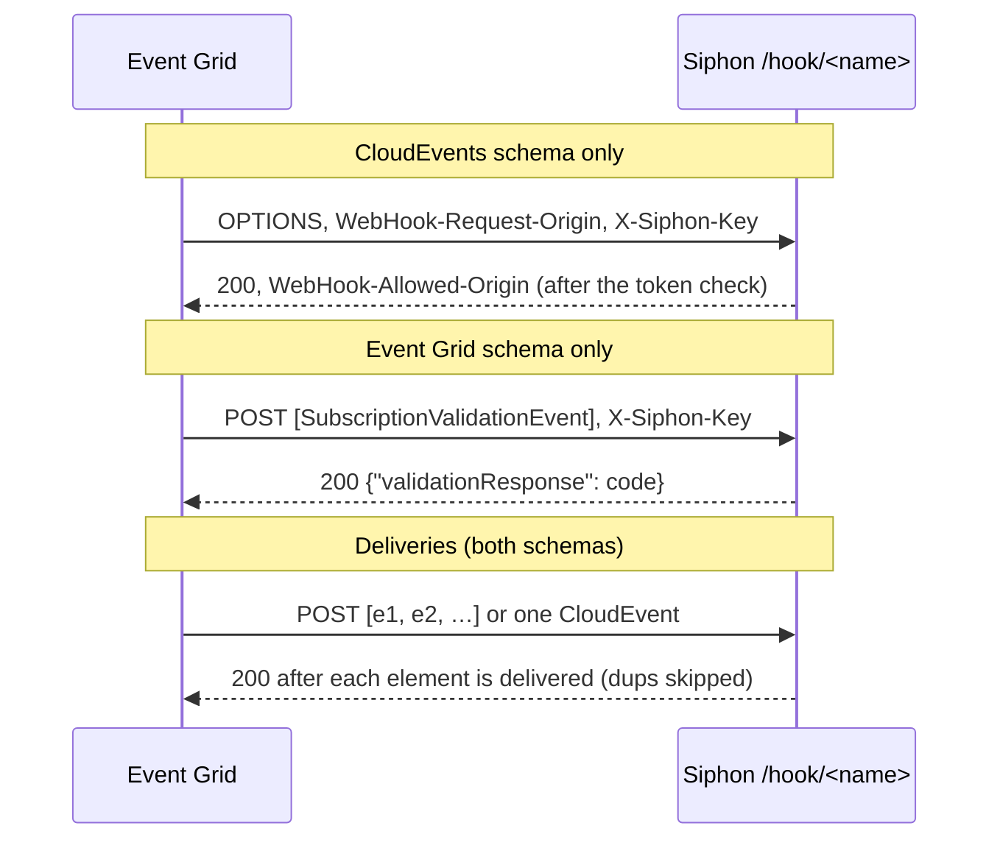

# Spec: Azure Event Grid events trigger rules

## Design

### Config (`internal/config/config.go`)

The webhook `Source` gains `Format string \`yaml:"format"\``: `""`
(today) or `eventgrid`.

**Validation:**
- `format: eventgrid` needs `signature: token`.
- `id` (the delivery id header) isn't allowed with it, because the id
  comes from each element.
- Any other format value is an error.

The schema is regenerated, and `explain` gets the field.

### Routing (`internal/web/web.go:171`)

Add `OPTIONS /hook/{source}`, served by the same per-source handler. The
handler (`webhook.go:91`) still answers `405` to anything that isn't
`POST`, except `OPTIONS` on an `eventgrid` source.

### Handler (`internal/source/webhook.go`)

`WebhookOptions` gains `Format`, passed from `internal/job/hooks.go`.

**On an `eventgrid` source:**
1. **The token check** (the existing `token` case) runs **first** for both
   `OPTIONS` and `POST`. A missing or wrong header gets 401, and nothing is
   answered.
2. **`OPTIONS`:** if `WebHook-Request-Origin` is present and is a plain
   hostname (`^[A-Za-z0-9.-]{1,253}$`), answer `200` with
   `WebHook-Allowed-Origin: <origin>` and `WebHook-Allowed-Rate: *`.
   Otherwise answer 400. Nothing is delivered.
3. **`POST`:** the body is decoded as JSON. An array is the batch, and an
   object is a single CloudEvent. Anything else gets 400.
4. **The validation event:** if the batch is exactly one element whose
   `eventType` is `Microsoft.EventGrid.SubscriptionValidationEvent`, answer
   `200 {"validationResponse": data.validationCode}`. The code must be a
   string of at most 128 characters. Nothing is delivered, and
   `validationUrl` is never fetched.
5. **Delivery:** each element must be an object with a non-empty string
   `id`, or the whole request gets 400. For each element:
   - `o.Limit.Allow`; if the limit is exceeded, answer 429, and Event Grid
     retries;
   - then `deliver(ctx, Event{Data: element, Headers: …}, id)`, where the
     replay key is the element's `id`;
   - duplicates are skipped silently.

   Answer `200` when every element is delivered or a duplicate, and `500`
   if any delivery fails. Event Grid then retries the batch, and the
   delivered ones collapse as duplicates.
6. **The headers map** drops the token header, as today.

**Every other source** behaves as today.

### Catalog (`internal/catalog/services.yaml`)

`azure-eventgrid` replaces the `not-yet` line (`:797`):
- category `cloud`, mark `EG`, `capabilities: [webhooks]`;
- creates `{{.name}}-hooks` (`hook: true`) with `type: webhook`,
  `signature: token`, `token_header: X-Siphon-Key`,
  `secret: {{generated "secret"}}` and `format: eventgrid`;
- setup: "Event Grid → your topic → Event subscription → Endpoint type Web
  Hook → the URL above. Additional features → Delivery properties → add
  header `X-Siphon-Key` with the key above, and mark it secret. Either
  event schema works."

The not-yet reason (the handshake) goes away.

### Template: `docs/templates/azure-keyvault-secret-expiry.yaml`

The "Ops & monitoring" category.
- A rule on `azure-eventgrid-hooks` with
  `when: '(event.eventType ?? event.type) == "Microsoft.KeyVault.SecretNearExpiry"'`,
  `on: each` and `id: event.id`.
- An ntfy notify: "Key Vault secret {{.event.subject}} expires soon". The
  argument starts with literal text.

`baseConfig` gets the `azure-eventgrid-hooks` source.

### Docs

`docs/connections/README.md` (generated), the webhook docs (a line on
`format: eventgrid`), `docs/llm.md`, and `go generate ./docs`.

## Alternatives rejected

- **Entra (AAD) bearer tokens.** They need JWKS verification, shared with
  Google Pub/Sub (#88). That's a follow-up.
- **A query-string secret** (`?code=`). Secrets in URLs end up in logs.
- **Fetching `validationUrl`** (manual validation). Siphon would make an
  outbound call chosen by the request.
- **Partial success codes for a batch.** Event Grid retries whole
  requests, and replay keys make that safe.

## Risks

- **Real Event Grid may not send the delivery header on the handshake.**
  The handshake then fails with 401, and the subscription can't be
  created. The owner's decision: verify on a real subscription before
  relaxing anything. Until then, the setup docs say so. A real-Azure check
  is a follow-up, because no subscription is available now.
- **A big batch is one request** under `MaxBody`. Event Grid caps it at
  1 MB and 5000 events, and the default `HTTPMaxBody` may need raising.
  The setup text mentions `limits.http_max_body`.
- **A rate limit hit partway through a batch** leaves the first elements
  delivered. The retry delivers the rest, and the first become
  duplicates.

## Verification

- **`internal/source` tests** using Microsoft's documented example
  payloads, copied into `testdata/`:
  - the validation event gets 200 with the code, and nothing is delivered;
  - the same without the token gets 401;
  - CloudEvents `OPTIONS` gets 200 with `WebHook-Allowed-Origin`, and 401
    without the token;
  - a batch of 3 is delivered as 3 events keyed by id;
  - re-sending it gives 3 duplicates and still 200;
  - a single CloudEvent object is delivered as one event;
  - an element without `id` gets 400 for the whole request;
  - a non-eventgrid source sends `OPTIONS` to 405;
  - a rate limit gives 429.
- **`internal/config`:** validation cases; the schema and explain tests.
- **`internal/catalog`:** the entry renders.
- **`TestTemplatesValidate`** and the docs tests.
- **`go vet ./... && go test -race ./...`.**
- **Manual:** curl both handshakes and a batch at a throwaway Siphon.
