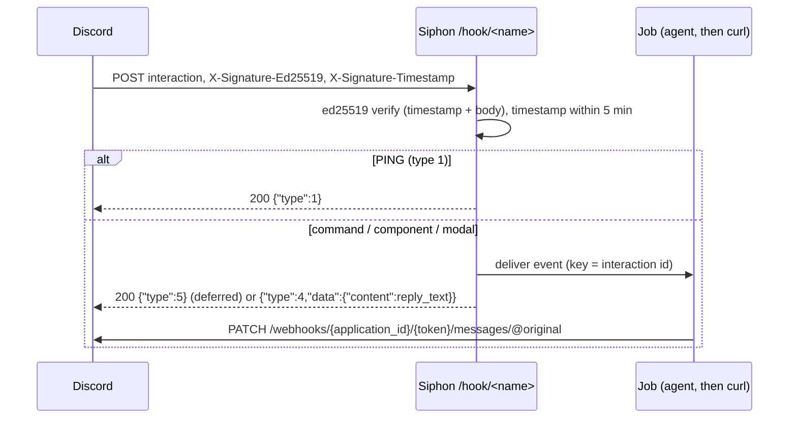

# Spec: Discord slash commands and interactions trigger rules

## Design



### Config (`internal/config/config.go`)

- **The signature enum** gains `ed25519`. The secret is the app's public
  key, 64 hex characters. A key the config can see is checked at load:
  - a literal or `file:` ref, read at validation the way other secrets are,
    must be 64 hex characters;
  - an `env:` ref is checked at the first request.
- **`ed25519` refuses** `signature_header`, `timestamp_header`,
  `token_header`, `token_field` and `id`.
- **`format`** gains `discord`, which needs `signature: ed25519`.
  - `eventgrid` still needs `token`.
  - `ed25519` without `format: discord` is allowed: it uses Discord's
    header names for generic ed25519 senders, and answers `202`.
- **`reply_text`** is allowed with `body-token` or with `format: discord`,
  and the ≤500 characters check is shared.

The schema is regenerated, and `explain` lists the enum values.

### Handler (`internal/source/webhook.go`)

**A new case, `"ed25519"`,** in the signature switch:
- `header = "X-Signature-Ed25519"`;
- `ts := r.Header.Get("X-Signature-Timestamp")`, which must pass
  `freshTS(ts, now)` (the existing 5-minute helper);
- `sig := hex.DecodeString(header value)`, which must be 64 bytes;
- `pub := hex.DecodeString(o.Secret)`, which must be 32 bytes. A bad key
  gets 500 with "public key misconfigured", and the key never appears in
  the output;
- `ed25519.Verify(pub, []byte(ts)+body, sig)`. Any failure gets
  `reject(401, "signature or timestamp invalid")`. Discord's URL check
  needs exactly 401;
- `signed = body`.

**A Discord branch,** after verification, like `serveEventGrid`. It's a
new `serveDiscord`:
1. Decode the JSON. Not an object, or no `type`, gets 400.
2. **`type == 1` (PING):** write `200`, `application/json`, `{"type":1}`.
   Nothing is delivered.
3. **`type == 4` (autocomplete):** write
   `{"type":8,"data":{"choices":[]}}`. Nothing is delivered: autocomplete
   can't wait for a rule, so it's out of scope.
4. **Otherwise** (2 command, 3 component, 5 modal):
   - The key is the interaction `id` (a string; missing gets 400).
   - Run `Limit.Allow` (429), then `deliver`. An error gets 500. A
     duplicate still gets the same response, because Discord doesn't retry
     a 2xx.
   - The response:
     - with `ReplyText`: `{"type":4,"data":{"content":ReplyText}}`;
     - otherwise, type 2 or 5 gets `{"type":5}` (deferred: "thinking…"),
       and type 3 gets `{"type":6}` (deferred update: no visible change).
5. **The headers map** drops `X-Signature-Ed25519` (as today, through
   `header`).

**`ed25519` without the discord format** delivers as the other modes do,
with the body-hash key and `202`.

### Catalog (`internal/catalog/services.yaml`)

`discord` replaces the not-yet line:
- category `chat`, `capabilities: [webhooks]`;
- fields: `name`; `public_key` (text, required, pattern `^[0-9a-f]{64}$`,
  help: "Developer Portal → your app → General Information → Public
  Key"); and an optional `reply`;
- creates `{{.name}}-hooks` (`hook: true`) with `type: webhook`,
  `signature: ed25519`, `format: discord`, `secret: {{secret "public_key"
  "secret"}}` and `reply_text` when set;
- setup: "Developer Portal → General Information → Interactions Endpoint
  URL = the URL above, then Save. Discord tests the URL, and Siphon answers
  it. Register your slash commands with Discord as usual."

### Template: `docs/templates/discord-ask-agent.yaml`

"Notifications & glue":
- **The rule** `discord-ask` on `discord-hooks`, with
  `when: 'event.type == 2 && event.data.name == "ask"'`, `on: each` and
  `id: event.id`;
- **the routine** `discord-ask-reply`, with steps `answer` (a model agent,
  no tools, prompt from `event.data.options[0].value`) and `reply`:

  ```
  cmd: [curl, -fsS, -X, PATCH, -H, "Content-Type: application/json",
        --data-raw, "{\"content\": {{printf \"%q\" .steps.answer.json.result}}}",
        "https://discord.com/api/v10/webhooks/{{.event.application_id}}/{{.event.token}}/messages/@original"]
  ```

  It carries the same `%q` shortcut comment as #82.

  The URL argument starts with literal `https://`. The interaction token
  is only in the URL argument, and it expires after 15 minutes. If the
  template has to name its egress, the plan follows how existing templates
  reach `ntfy.sh`.
- `baseConfig` gets `discord-hooks: { type: webhook, signature: ed25519, format: discord, secret: env:AGW_HOOK }`.
  `TestTemplatesValidate` must accept an `env:` key: it's checked at run
  time, not at load.

### Docs

The webhook docs gain an `ed25519` row and the Discord format line, plus
`docs/llm.md`, and `go generate ./docs`.

## Alternatives rejected

- **A Discord bot on the gateway, for channel messages.** It's a long-lived
  connection and needs a bot token. That's a different source type, and
  out of scope.
- **Answering slash commands synchronously with the agent's answer.**
  Discord's 3-second limit is too short for an agent.
- **Storing a bot token for follow-ups.** The interaction token in the
  event is enough, and it expires.

## Risks

- **The interaction token is in the event data and job payload** for its
  15-minute life. It can only edit that one interaction's messages. The
  docs say so.
- **Discord's URL check sends bad signatures,** and must get 401. A test
  covers it.
- **ed25519 public keys aren't secret,** but they're stored like secrets.
  That's harmless.

## Verification

- **`internal/source` tests,** with a key pair generated in the test
  (`ed25519.GenerateKey`):
  - a signed PING gets 200 `{"type":1}`, and nothing is delivered;
  - a bad signature, a stale timestamp or a missing header gets 401;
  - a slash command is delivered, keyed by `id`, with response
    `{"type":5}`;
  - a component gets `{"type":6}`;
  - `reply_text` gives `{"type":4,…}`;
  - autocomplete gets `{"type":8,…}`, and nothing is delivered;
  - a duplicate gets the same 200 and is delivered once;
  - a bad public key gets 500, without the key in the body;
  - generic `ed25519` without the format gets 202.
- **`internal/config`:** validation cases; the schema and explain tests.
- **`internal/catalog`:** the entry renders, and the `public_key` pattern
  is enforced.
- **`TestTemplatesValidate`,** the docs tests, and
  `go vet ./... && go test -race ./...`.
- **Manual:** sign a PING and a command with a test key using a tiny Go
  program in the scratchpad, and curl them to a throwaway Siphon.
