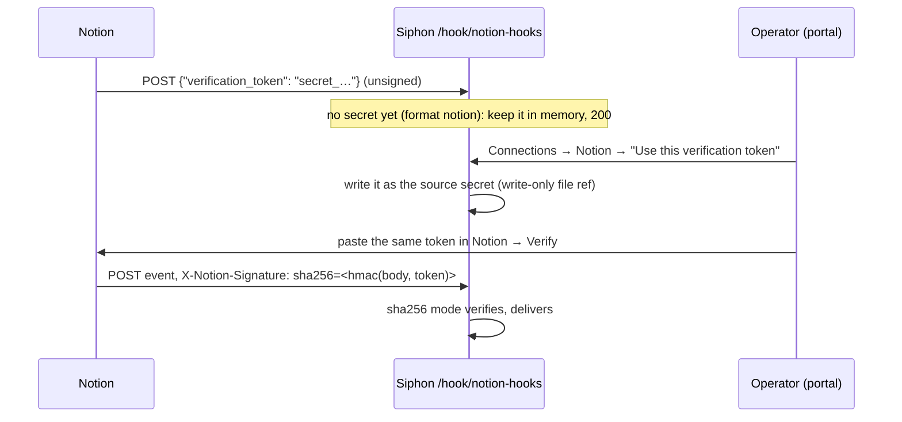

# Spec: Notion page and database events, and Notion tools for agents

## Design

### Config (`internal/config/config.go`)

- **`format` gains `notion`,** which needs `signature: sha256`,
  `signature_header: X-Notion-Signature` and `signature_prefix: sha256=`.
  The catalog entry sets all three. Validation checks they're present
  together.
- **With `format: notion`, `secret` may be empty.** That's the "awaiting
  verification" state. The required-secret check at `config.go:1503`
  skips it, and a warning says "source <n>: awaiting Notion's verification
  token; no events are delivered until it is accepted".

The schema and `explain` are updated.

### Handler (`internal/source/webhook.go`)

`WebhookOptions` gains `OnVerificationToken func(token string)`, set by
`internal/job/hooks.go`.

**When `o.Format == "notion"` and `o.Secret == ""`:**
- **Accepted:** a JSON object with exactly one key, `verification_token`,
  whose string value matches `^secret_[A-Za-z0-9]{20,100}$`. Siphon calls
  `OnVerificationToken`, and answers `200` with an empty body. Nothing is
  delivered.
- **Anything else** gets `401 "awaiting verification token"`.

**When a secret is set,** the normal `sha256` path runs.
- A later verification POST is unsigned, so it gets 401 like any unsigned
  request. That's correct: it can't replace the secret.
- To re-verify, the operator clears the secret: YAML, or a portal
  "Reset verification" button. That's covered in the plan, if it's cheap.

### The pending token: in memory, on the pipeline (`internal/job`)

- **A map,** `map[source]pendingToken{token, at}`, under a mutex.
- **Only the latest is kept.** A new verification POST replaces it.
- **It isn't persisted.** A restart loses it, and Notion's "Resend token"
  sends it again. That's documented. No migration is needed.

### Portal and API (`internal/web`)

- **A notion source with no secret** shows, on its connection or source
  page (operator only):
  - "Awaiting Notion's verification token" while nothing has been
    captured;
  - once one has, the token in a `<code>` (selectable) and its age, plus a
    "Use this token" button.
- **`POST /api/sources/{name}/notion-verification`,** with the operator
  role:
  - it takes the pending token, sets it as the source's `secret` through
    the existing `withSecrets`/`write` path (a write-only file ref, with an
    audit row), and clears the pending entry;
  - it gets 404 when nothing is pending, and 409 when the source already
    has a secret;
  - the portal button posts to it through the usual CSRF-protected form.
- **CSP-clean templates;** the token is html-escaped.

### Catalog (`internal/catalog/services.yaml`)

`notion` replaces the not-yet line (`:855`).

- `capabilities: [tools, webhooks]`.
- **Fields:** `name`, plus `*f_webhook` (default on).
- **Creates:**
  - `{{.name}}`: `type: mcp`, `url: https://mcp.notion.com/mcp`,
    `auth: { oauth: {} }`;
  - `{{.name}}-hooks`, when `webhook`: `type: webhook`, `signature: sha256`,
    `signature_header: X-Notion-Signature`, `signature_prefix: sha256=`,
    `format: notion`, with **no secret**.
- **Setup text:**
  1. In Notion: integrations → your integration → Webhooks → create a
     subscription with the URL above.
  2. In Siphon: Connections → Notion → Use this verification token.
  3. Back in Notion: paste the token and Verify.
  4. For agent tools: Connections → Notion → Log in.

  It also notes "OAuth login not yet verified against Notion" (the owner's
  decision).

### Template: `docs/templates/notion-page-summary.yaml`

"Ops & monitoring":
- **The rule** fires on `event.type == "page.content_updated"`, with
  `on: each` and `id: event.id`, `cooldown: 1m`;
- **an agent** with `mcp: [notion]` and
  `allowed_tools: [mcp__notion__fetch]` reads the page by
  `event.entity.id` and summarises it, then notifies by ntfy. Approval is
  the default, because the agent reads workspace content.

Check the Notion tool name against its server's tool list when that's
possible. Until then, the template says the tool names come from the Notion
MCP server.

`baseConfig` gets `notion` (an mcp source with an oauth stub) and
`notion-hooks`.

### Docs

The webhook docs gain `format: notion`, and `docs/llm.md` gets a line.
Then `go generate ./docs`.

## Alternatives rejected

- **Persisting the pending token in the store.** A migration for a value
  that Notion resends on request.
- **Auto-accepting the first token.** Anyone who knew the URL could plant a
  secret before Notion does. An operator action makes it deliberate.
- **Asking the user to fetch the token from Notion.** Notion doesn't show
  it; it only POSTs it.

## Risks

- **Before acceptance, anyone can POST a well-formed token** that the
  operator might accept. If they accept the attacker's token, Notion's
  Verify fails, because Notion compares it with its own. So the failure is
  loud. The portal shows when the token arrived, to help.
- **The Notion MCP OAuth flow is unverified.** It's marked in the setup
  text.
- **The webhook payloads carry only IDs** (`entity.id`, `type`), not
  content. The agent must fetch. That's documented in the template.

## Verification

- **`internal/source` tests:**
  - with no secret, the verification body gets 200, the callback receives
    the token, and nothing is delivered;
  - wrong shapes get 401: extra keys, a bad token format, a signed event;
  - with a secret, a correct `X-Notion-Signature` delivers;
  - a verification POST after the secret is set gets 401.
- **`internal/job`:** the pending map keeps only the latest token.
- **`internal/web`:**
  - the source page shows the pending token (operator) and the button;
  - the API stores the secret (the item YAML holds a file ref, and the
    secret file holds the token), then clears pending;
  - 404 with nothing pending, 409 with a secret already set;
  - a viewer gets 403.
- **`internal/config`** cases; the catalog render; `TestTemplatesValidate`;
  the docs tests; `go vet ./... && go test -race ./...`.
- **Manual:** curl the verification body to a throwaway Siphon, accept it
  through the API, then POST an event signed with that token, and see it
  delivered.
