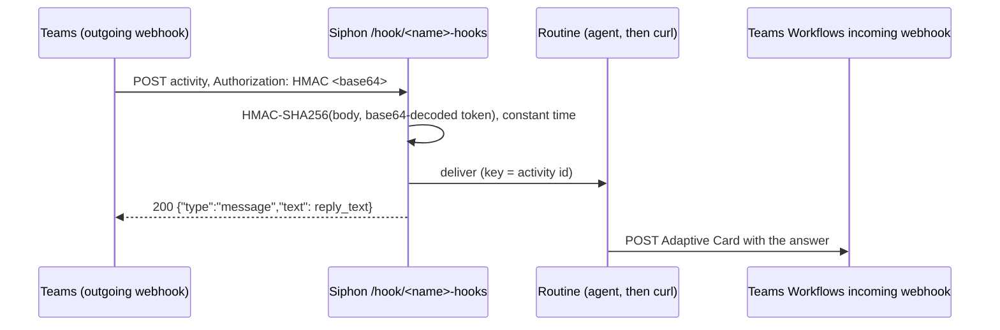

# Spec: Microsoft Teams outgoing webhooks trigger rules

## Design

### Config (`internal/config/config.go`)

- **The signature enum** gains `teams-hmac`.
  - The secret is the security token Teams shows, which is base64.
  - When its value is known at validation, it must decode as standard
    base64 to at least 16 bytes. Skip `config.StubSecret`, the portal's
    stand-in, as #84 does.
  - `signature_header`, `timestamp_header`, `token_header`, `token_field`
    and `id` aren't allowed.
- **`reply_text`** is also allowed with `teams-hmac`, under the same
  500-character limit.

The schema and `explain` are updated.

### Handler (`internal/source/webhook.go`)

**A new case, `"teams-hmac"`:**
- **The header:** `header = "Authorization"`. Its value must be
  `HMAC <base64>`; the base64 part decodes to 32 bytes.
- **The key:** `base64.StdEncoding.DecodeString(o.Secret)`. A key that
  won't decode gets 500 "secret misconfigured", and is never echoed.
- **The check:** `hmac.Equal(sha256-HMAC(key, body), sig)`. A failure gets
  `reject(401, "signature invalid")`.
- **`signed = body`.**

**After verification, for `teams-hmac`:**
- **The replay key** is the activity `id` from the JSON body, if it's a
  non-empty string; otherwise the body hash.
- **The response** is always `200`, `application/json`,
  `{"type":"message","text": reply_text}`, with empty text when
  `reply_text` isn't set. Teams treats a non-JSON or non-2xx answer as
  failed and shows an error in the channel.
- **A duplicate** gets the same 200 reply.

This mirrors `reply_text` for `body-token`. It's a small branch where the
`202` is written today, not a new `serve*` function. Teams posts one
activity per request, so the single `Limit.Allow` applies.

### Catalog (`internal/catalog/services.yaml`)

`teams` replaces the not-yet line (`:970`).
- **Fields:**
  - `name`;
  - `token` (secret, required: "the security token Teams shows once when
    you create the outgoing webhook");
  - `reply` (optional immediate reply).
- **Creates `{{.name}}-hooks`:** `hook: true`, `type: webhook`,
  `signature: teams-hmac`, `secret: {{secret "token" "secret"}}`, and
  `reply_text` when set.
- **Setup:**
  - In Teams: the team → Manage team → Apps → Create an outgoing webhook,
    with the callback URL the URL above. Copy the security token and paste
    it here.
  - For replies, create a Workflows "Post to a channel when a webhook
    request is received" flow, and use its URL in the template.
  - The callback URL needs `server.public_url` set.

### Template: `docs/templates/teams-ask-agent.yaml`

"Notifications & glue":
- **The rule** `teams-ask` on `teams-hooks`, `when: 'event.type == "message"'`,
  with `on: each`, `id: event.id` and `cooldown: 30s`.
- **The agent** `teams-ask`: a model with no tools. Its prompt is
  "{{.event.text}}", with the note that it's a chat message containing an
  `<at>…</at>` mention to ignore, and that the text is untrusted.
- **The routine** `teams-ask-reply`:
  1. the `answer` step;
  2. `post`, with
     `cmd: [curl, -fsS, -H, "Content-Type: application/json", --data-raw, "{\"type\":\"message\",\"attachments\":[{\"contentType\":\"application/vnd.microsoft.card.adaptive\",\"content\":{\"type\":\"AdaptiveCard\",\"version\":\"1.4\",\"body\":[{\"type\":\"TextBlock\",\"wrap\":true,\"text\":{{printf \"%q\" .steps.answer.json.result}}}]}}]}", https://example.webhook.office.com/CHANGE-ME]`.

     It carries the same `%q` shortcut comment as #82.
  3. a `sorry` step on failure, as #84 has.
- **The catalog entry** gets `reply: "Working on it…"` as the suggested
  value in its help.

`baseConfig` gets
`teams-hooks: { type: webhook, signature: teams-hmac, secret: env:AGW_TEAMS_KEY }`,
with the test helpers setting a valid base64 key, as #84 did for discord.

### Docs

The webhook docs row, `docs/llm.md`, and `go generate ./docs`.

## Alternatives rejected

- **A full Teams bot** (Azure Bot Service with Bot Framework JWT
  verification). It's the owner's decision: later.
- **Answering with the agent's reply inside the 5 seconds.** It's too
  short for an agent.
- **The retired Office 365 incoming-webhook connectors.** Microsoft
  replaced them with Workflows, so the template uses Workflows.

## Risks

- **No timestamp in the signature,** so a captured request could be
  replayed. The activity-id replay key stops a byte-identical replay
  within the replay store's 7 days. That's documented, as for the other
  modes without timestamps.
- **The Workflows card format may change.** The template is an example,
  and the docs link Microsoft's card reference.
- **Teams shows an empty reply as nothing,** as expected. If a tenant shows
  an empty bubble instead, the user sets `reply_text`.

## Verification

- **`internal/source` tests:**
  - a body signed with a base64 key and `Authorization: HMAC <sig>` gets
    200 `{"type":"message","text":""}` and a delivery keyed by `id`;
  - with `reply_text`, the text is in the reply;
  - a duplicate gets the same 200 and one delivery;
  - a wrong signature, a missing header, the wrong scheme (`Bearer`) or
    non-base64 gets 401;
  - a bad key gets 500, without the key in the body;
  - the event headers have no `authorization`.
- **`internal/config`** cases (including the `StubSecret` skip); the
  catalog render; `TestTemplatesValidate`; the docs tests;
  `go vet ./... && go test -race ./...`.
- **Manual:** curl a signed activity at a throwaway Siphon, and check the
  JSON reply and the job.
