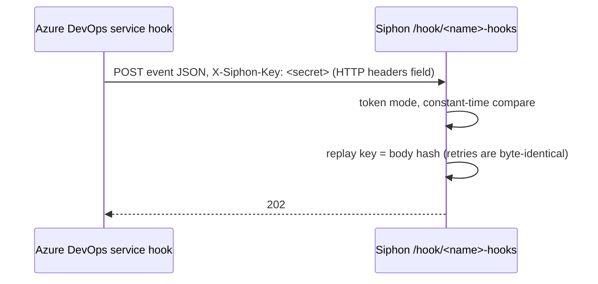

# Spec: Azure DevOps service hooks trigger rules

## Design

**No new Go code.** Azure DevOps **Web Hooks** subscriptions send custom
HTTP headers, so the existing `token` mode verifies them:



### The replay key: no `body.<path>` option (a change from the intent)

The intent proposed `id: body.<path>`, to key duplicates on
`notificationId`. The code shows that isn't needed, and isn't stronger:

- `id: header.X` only checks the header is *present*
  (`internal/source/webhook.go:310`). The replay key is the
  signature-derived key or the body hash (`webhook.go:321-326`), because
  "delivery IDs are not signed". A body field in `token` mode is just as
  unsigned, so it shouldn't be trusted as the key either.
- Azure DevOps retries a failed delivery with the same payload, so the body
  hash already catches retries.

So the entry uses the body hash, as `token` mode does today. This is noted
for the owner at spec review.

### Catalog (`internal/catalog/services.yaml`)

`azure-devops` replaces the not-yet line (`:1012`).

```yaml
  - id: azure-devops
    name: Azure DevOps
    mark: AD
    category: code
    summary: "Azure DevOps service hooks (builds, releases, work items, pull requests) by webhook with a shared header token. Agent tools come later."
    capabilities: [webhooks]
    status: available
    templates: [azure-devops-build-failed, azure-devops-new-bug]
    fields:
      - {<<: *f_name, default: azure-devops}
    creates:
      - kind: sources
        name: '{{.name}}-hooks'
        when: 'true'
        hook: true
        yaml: |
          type: webhook
          signature: token
          token_header: X-Siphon-Key
          secret: {{generated "secret"}}
    setup: |
      Project settings → Service hooks → + → Web Hooks → choose the event
      (Build completed, Work item created, Pull request created, …) → Next.
      URL: the URL above. HTTP headers: X-Siphon-Key:<the secret above>.
      Leave Basic authentication empty. Resource details to send: All (the
      templates read resource fields). Test, then Finish.
      server.public_url must be set for the URL to be reachable.
```

The `token` mode's existing warning ("weaker than an HMAC; a captured
delivery can be replayed") applies, and the setup text keeps it visible.
Azure DevOps offers nothing stronger for Web Hooks.

### Templates (`docs/templates/`)

- **`azure-devops-build-failed.yaml`** ("Ops & monitoring"):
  - the rule fires on
    `event.eventType == "build.complete" && event.resource.result == "failed"`,
    with `on: each` and `id: string(event.resource.id)`;
  - an ntfy notification: "Build {{.event.resource.buildNumber}}
    ({{.event.resource.definition.name}}) failed".
- **`azure-devops-new-bug.yaml`** ("Notifications & glue"):
  - the rule fires on
    `event.eventType == "workitem.created" && event.resource.fields["System.WorkItemType"] == "Bug"`,
    with `on: each` and `id: string(event.resource.id)`;
  - an ntfy notification with `System.Title`.

  Check that expr-lang indexes a dotted key like that, and adapt it if
  `TestTemplatesValidate` objects.
- **`baseConfig`** gets
  `azure-devops-hooks: { type: webhook, signature: token, token_header: X-Siphon-Key, secret: env:AGW_HOOK }`.

### Docs

`docs/connections/README.md` (generated) lists Azure DevOps as available.
The webhook docs note that Azure DevOps is configured with the `token` mode
through its HTTP headers field, and `docs/llm.md` gets a line. Then
`go generate ./docs`.

### A follow-up issue (opened with the PR)

"Azure DevOps agent tools": the remote MCP with `auth.oauth` and an Entra
app registration (needs a tenant to test), or the local `@azure-devops/mcp`
with a PAT (needs Nix packaging).

## Alternatives rejected

- **Basic auth verification.** It's weaker, and there's a better option
  (the header token).
- **`id: body.<path>`.** It's unsigned in `token` mode, and adds nothing
  over the body hash for byte-identical retries (see above).
- **Agent tools now.** That's the owner's decision: later.

## Risks

- **"Resource details to send: Minimal" or "None"** removes the fields the
  templates read. The setup text says to choose All.
- **The token travels on every delivery,** as for every `token` source.
  That's documented.
- **Event payload shapes vary by event type.** The templates cover two
  common ones, and the rest follow Microsoft's event reference (linked in
  the docs).

## Verification

- **`internal/catalog`:** `TestAzureDevOpsEntry` renders `<name>-hooks`
  with `token` / `X-Siphon-Key` and a generated secret.
  `TestCatalogEntriesRenderAndCommit` passes.
- **`TestTemplatesValidate`,** with the two templates against
  `baseConfig`; the docs tests; `go vet ./... && go test -race ./...`.
- **Manual:** curl a sample `build.complete` payload (Microsoft's
  documented example, with result "failed") with the header to a
  throwaway Siphon, and see the rule fire. A wrong header gets 401.
